# RTAL-EAI-015-SYNTECH-Synthesizer

### Inspired by the legendary Elka Synthex · Built for ESP32-S3 · Powered by real-time DSP

**A compact, polyphonic virtual-analog synthesizer with a touch-first interface, dual-layer architecture, deep modulation and comprehensive MIDI control.**


**[Overview](#the-project) · [Sound engine](#sound-engine) · [Touch interface](#touch-interface) · [MIDI](#midi-control) · [Gallery](#interface-gallery) · [Credits](#credits--acknowledgements)**


> [!IMPORTANT]
> **Firmware source release V1.0.0 FINAL.** The supplied firmware source has been inspected and its six bundled host-test groups passed in this publication audit. The source has *not* been recompiled for ESP32-S3 with Arduino IDE here, nor has this packaged copy been reflashed as part of the audit. A prepared SD preset bank is essential; see [Installation](#build--installation) and [Release audit](doc/RELEASE_AUDIT_V1.0.0.md).


https://github.com/user-attachments/assets/709780a9-422d-4dee-b969-57c467f08526

## The project

**RTAL SYNTECH** is a standalone embedded virtual-analog synthesizer inspired by the architecture and musical spirit of the **Elka Synthex**. The project combines the classic signal-flow concepts of a vintage polyphonic instrument with a modern graphical user interface, external MIDI control and an ESP32-S3 real-time audio system.

Our goal is not a circuit-identical hardware replica or an officially endorsed Elka product. It is an independently developed instrument that brings Synthex-inspired synthesis into a small, approachable embedded platform — with transparent technical documentation and appropriate upstream attribution.

**Deutsch:** RTAL SYNTECH ist ein eigenständiges, polyphones Virtual-Analog-Synthesizer-Projekt auf ESP32-S3-Basis, inspiriert vom legendären Elka Synthex. Im Mittelpunkt stehen ein musikalischer Klangcharakter, zwei editierbare Klangebenen, umfangreiche Modulationsmöglichkeiten und eine direkt am Gerät bedienbare Touch-Oberfläche. Diese Veröffentlichung dokumentiert die Firmware V1.0.0 FINAL.

### At a glance

| Area | RTAL SYNTECH |
|:--|:--|
| Project ID | **RTAL-EAI-015** |
| Synthesis | Embedded virtual analog / subtractive synthesis |
| Target controller | **ESP32-S3**, Guition **JC4827W543** main module |
| Interface | **480 × 272** color touchscreen, **LVGL 8.4** |
| Audio output | Digital **I²S** audio to an external DAC / audio stage |
| Firmware sample rate | **32,000 samples/s (32 kHz)** |
| Polyphony policy | **6 voices** |
| Layers | **UPPER / LOWER**, with single, split and double concepts |
| Oscillators | 2 per voice; waveform selection, PWM, detune and oscillator sync |
| Additional sources | Noise, pink-noise option, ring and cross modulation |
| Filtering | Multimode filter; LP24 musical resonance behavior is an explicit project focus |
| Modulation | 2 LFOs, filter and amplifier envelopes, two six-destination LFO routing matrices |
| Effects | Chorus and reverb with on-screen controls |
| Presets | 128 SD slots: **P000–P079 factory designation**, **P080–P127 user designation**; files must exist on the SD card |
| MIDI | DIN MIDI, MIDI Program Change, configurable CC mapping, MIDI Learn |
| Control schemes | **STANDARD** (direct CC) and **MOPHO** (CC32 banked CC) |
| Engineering | Real-time audio tasking, asynchronous user interface, on-screen DSP/XRUN/queue diagnostics |

> **Screenshot note:** The gallery combines historical 44.1 kHz screen captures with later 32 kHz matrix captures. **The actual V1.0.0 FINAL source runs at 32 kHz using 256-frame audio blocks.** XRUN readouts in older images are historical and do not characterize the final release.

## Why SYNTECH?

A great analog synthesizer is more than a collection of oscillators. Its personality comes from how oscillators interact, how filters respond to modulation, how envelopes shape a sound, and how easily musicians can reach those parameters. RTAL SYNTECH puts all of this on a compact touchscreen while keeping the most timing-critical DSP work separate from the user interface.

The instrument is designed around three priorities: **sound character**, **musical control** and **real-time stability**. Particularly DSP-intensive cross-modulation combinations are handled conservatively: preserving clean audio is more important than advertising a theoretical maximum polyphony under every condition.

## Sound engine

### Oscillators and mixing

Each synthesis voice provides two oscillator paths with independently adjustable waveforms and pulse width. OSC2 detune, oscillator sync, oscillator mixing and noise broaden the sound palette from classic pads and brass to animated sync leads and metallic textures.

The mixer and cross-modulation section provides **OSC1/OSC2 levels**, **noise**, **CROSS1**, **CROSS2** and **ring modulation**. CROSS1/CROSS2 are computationally demanding at higher depths; fewer simultaneous notes may be needed in high-load conditions.

### Filters and envelopes

The filter section brings together **cutoff**, **resonance**, **filter type**, **envelope amount**, **keyboard tracking** and **pink noise** controls. A carefully tuned **MUSICAL LP24 resonance curve** is part of the project's sound-design direction. Separate filter and amplifier ADSR envelopes provide independent control of movement and loudness.

### LFOs and modulation matrices

Two configurable LFOs support rate, waveform, delay, sync and modulation depth controls. Each LFO can be routed independently and with bipolar amounts to **OSC1 pitch**, **OSC2 pitch**, **OSC1 PWM**, **OSC2 PWM**, **filter cutoff** and **amplitude**. The routing design allows performance-oriented sounds as well as slow, evolving patches.

### Effects

A dedicated FX page exposes **chorus** and **reverb** switches and their key parameters. The captured interface shows chorus mix/rate/depth and reverb mix/size/damping.

## Touch interface

The interface is purpose-built for the **JC4827W543's 480 × 272 display**. Large touch targets and clearly separated functional pages make synthesis parameters accessible without a mouse, external editor or extensive menu diving.

The main navigation provides **OSC**, **MIX**, **FILTER**, **F-ENV**, **A-ENV**, **LFO** and **FX**, alongside **LAYER**, **MODE**, **MIDI**, **BANK** and preset navigation. In the LFO area, the user can switch between **LFO 1**, **LFO 2**, **MAIN**, **MATRIX A** and **MATRIX B**.

An on-screen diagnostic line reports DSP timing as well as **XRUN** and command-queue counters. The counters make timing issues visible during development rather than hiding them behind the UI.

### Interface gallery

*Click an image in GitHub to view its full resolution.*

| Oscillators | Mixer | Filter |
|:--:|:--:|:--:|
| 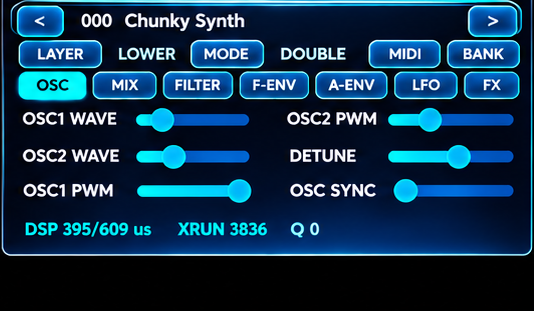 | 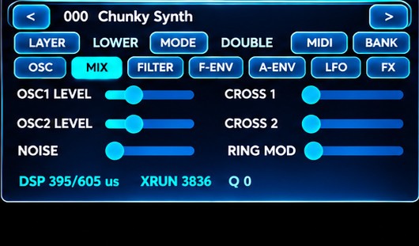 | 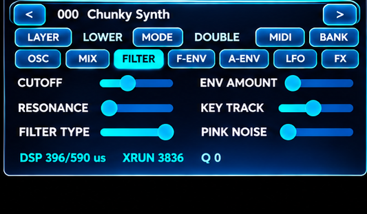 |
| **OSC** | **MIX** | **FILTER** |

| Filter envelope | Amplifier envelope | Effects |
|:--:|:--:|:--:|
| 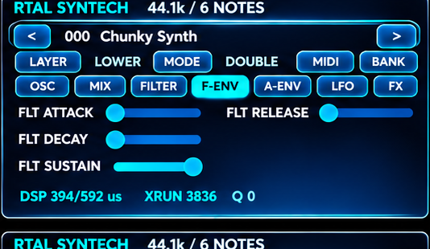 | 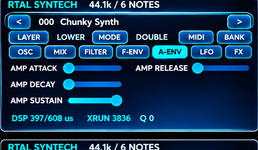 | 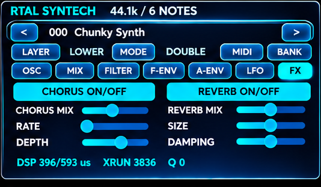 |
| **F-ENV** | **A-ENV** | **FX** |

| LFO controls | MIDI setup | Preset manager |
|:--:|:--:|:--:|
| 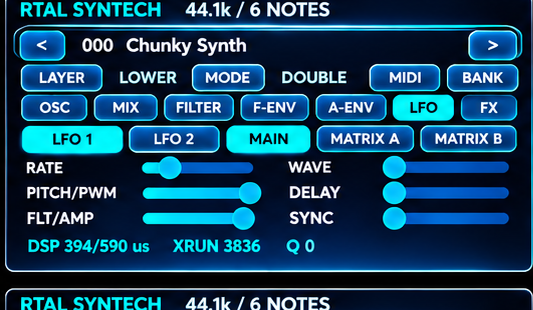 | 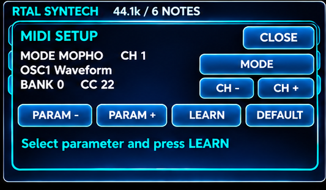 | 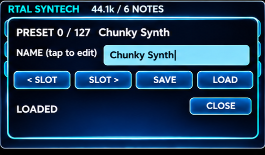 |
| **LFO** | **MIDI** | **PRESET** |

### Modulation matrix: detailed views

These enlarged captures highlight the modulation architecture and provide a closer look at the precision-oriented touch controls.

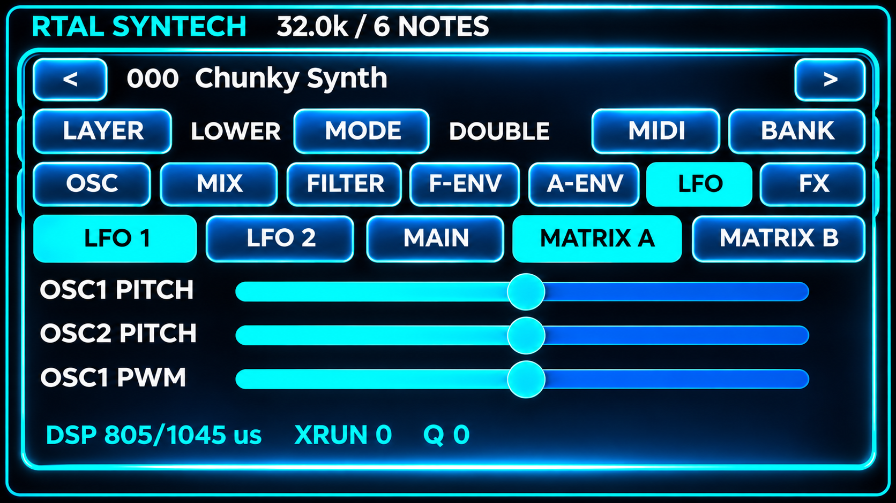

*Matrix A — OSC1/OSC2 pitch and OSC1 PWM modulation.*

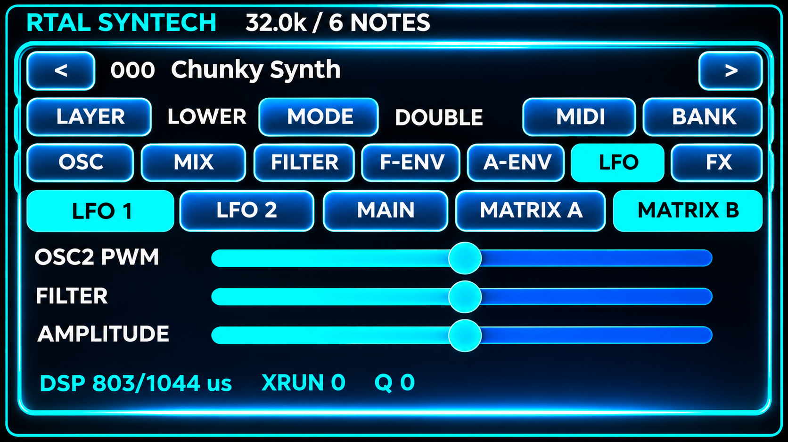

*Matrix B — OSC2 PWM, filter and amplitude modulation.*

### Complete interface overview

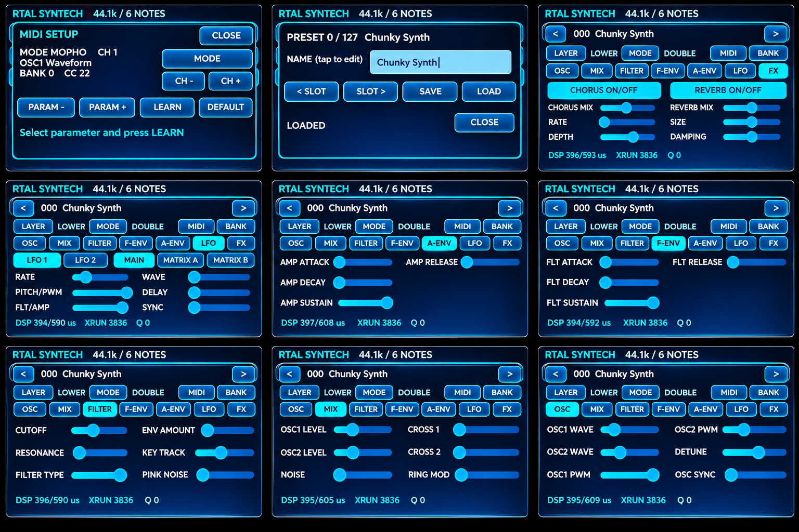

## MIDI control

MIDI is a central part of SYNTECH's design, not an afterthought. Along with note and patch selection, the project provides two alternative parameter-control schemes and a MIDI Learn interface for controller integration.

**STANDARD MODE** assigns a direct MIDI CC to each parameter. For example, the supplied mapping uses **CC27** for Filter Cutoff, **CC28** for Resonance and **CC14** for OSC1 Waveform.

**MOPHO MODE** uses **CC32** to select the active parameter bank first; the same CC number can then address a different function in another bank. The selected bank persists until changed. For example, **Bank 0 / CC102** controls Filter Cutoff, while **Bank 1 / CC106** controls LFO1 Rate and **Bank 2 / CC106** controls LFO2 Rate.

| Example parameter | Standard mode | MOPHO mode |
|:--|:--|:--|
| OSC1 waveform | CC14 | Bank 0 → CC22 |
| OSC2 waveform | CC15 | Bank 0 → CC26 |
| OSC1 PWM | CC16 | Bank 0 → CC23 |
| Filter cutoff | CC27 | Bank 0 → CC102 |
| Filter resonance | CC28 | Bank 0 → CC103 |
| Filter envelope attack | CC33 | Bank 0 → CC109 |
| Amplifier envelope attack | CC37 | Bank 0 → CC118 |
| LFO1 rate | CC42 | Bank 1 → CC106 |
| LFO2 rate | CC45 | Bank 2 → CC106 |
| LFO1 → OSC1 pitch | CC59 | Bank 1 → CC111 |
| LFO2 → filter cutoff | CC73 | Bank 2 → CC119 |
| Chorus mix | CC48 | Bank 1 → CC28 |
| Reverb mix | CC51 | Bank 1 → CC102 |

The source spreadsheet also defines **MIDI Learn identifiers**, **parameter ranges**, **UPPER/LOWER or global scope**, and the rest of the CC matrix. MIDI channel selection is presented through the on-device MIDI dialog; the design supports configurable MIDI channel handling. **MIDI Program Change 0–127** is intended to address the 128 patch slots.

**[Complete MIDI CC reference](midi_implementation/README.md)** · **[Original editable MIDI spreadsheet](midi_implementation/RTAL_SYNTECH_MIDI_CC_STANDARD_MOPHO_EDITOR.xlsx)**
)**

> [!NOTE]
> This table is a documentation extract from the supplied MIDI editor workbook; it should not be mistaken for an automated verification of the exact firmware currently running in every screenshot.

## Presets and performance

The patch manager is designed for **128 slots**, with a dedicated bank of 80 factory patches and 48 user patches. The touch UI includes patch browsing, a name field, LOAD and SAVE controls and a visual indication of loading state. SD storage and MIDI Program Change access support both standalone use and integration with a DAW or MIDI controller.

- Normal voice target: **6-note polyphony**.
- Firmware audio rate: **32 kHz**, with a fixed real-time audio block strategy.
- Live timing counters: **DSP processing time, XRUNs and command queue state**.

Because screenshots cover multiple development revisions, displayed historical counter values should not be treated as final benchmarks.

## Embedded platform and architecture

RTAL SYNTECH targets the **Guition JC4827W543** ESP32-S3 touch-display board. The platform combines a responsive QSPI LCD, capacitive touch input, PSRAM and a hardware I²S output path. The audio engine, MIDI handling and GUI are kept logically separated so that editing a patch or switching pages does not require the audio interrupt path to block on drawing or storage operations.

```text
External MIDI controller / sequencer
                 |
             DIN MIDI IN
                 |
           MIDI input task
                 |
        Parameter / note events
                 |
          FreeRTOS queue
                 |
    +---------------------------+
    | Real-time audio engine    |
    |  Voice allocation         |
    |  OSC + MIX + FILTER       |
    |  ADSR + LFO matrices      |
    |  Chorus + Reverb          |
    +---------------------------+
                 |
              I2S DAC ------> Stereo audio out

    Touch GUI / patch manager --> queued engine updates
                   |
                 SD card
```

This is a **conceptual architecture diagram**, not a pin-level wiring schematic or a promise that each branch exists unchanged in every development revision. Hardware connection tables and reproducible build settings will be published with a source release.

## Build & installation

**Required hardware:** Guition JC4827W543 ESP32-S3 display board (NV3041A QSPI, GT911 touchscreen), microSD card, external I²S-compatible DAC/audio output stage and optionally a DIN-MIDI interface with proper electrical circuitry. Firmware pin constants include **I²S BCLK GPIO16, LRCK GPIO15, DOUT GPIO7**, **DIN MIDI RX GPIO17, TX GPIO18**, and SD SPI **SCK GPIO12, MISO GPIO13, MOSI GPIO11, CS GPIO10**. See [`PINS_JC4827W543.h`](firmware/RTAL_SYNTECH_V1_0_0_FINAL/PINS_JC4827W543.h) for display and touch wiring.

1. Prepare **Arduino IDE 2.3.10**, **Arduino-ESP32 core 3.3.11** and **LVGL 8.4.x**, the firmware's documented development baseline. Use a compatible ESP32-S3 board profile with the board's 16 MB flash / 8 MB PSRAM configuration. The firmware requires **USB Mode → USB-OTG (TinyUSB)** because it uses USB MIDI.
2. Open [`RTAL_SYNTECH_V1_0_0_FINAL.ino`](firmware/RTAL_SYNTECH_V1_0_0_FINAL/RTAL_SYNTECH_V1_0_0_FINAL.ino) **inside its directory**, keeping sibling `.cpp`, `.c` and `.h` files in place. Refer to the supplied `lv_conf.h` for the intended LVGL setup.
3. Prepare a microSD card with the directory `/RTAL_SYNTECH/PRESETS/` and compatible, existing `P000.rtal` … `P127.rtal` version-2 preset files. **No complete preset bank is bundled in this release.** The firmware does not synthesize a replacement factory bank and will not reach normal playback without at least one valid preset.
4. Wire the DAC and MIDI safely, compile and flash with the intended hardware. Take an existing SD preset backup before saving patches or changing firmware.

> [!CAUTION]
> This package contains source code but **no independently verified ready-to-flash `.bin`** and **no complete factory preset distribution**. Building and flashing are the user's responsibility. A final reproducible binary build and clean-device acceptance test are still recommended before marking the GitHub release as fully deployment-ready.

## Sound demo

Listen to the original SYNTECH demo (GitHub attachment):

https://github.com/user-attachments/assets/709780a9-422d-4dee-b969-57c467f08526

## Documentation

- **[Detailed user manual — German](doc/RTAL_SYNTECH_Benutzerhandbuch_V1.0.0.md)** · [PDF version](doc/RTAL_SYNTECH_Benutzerhandbuch_V1.0.0.pdf)
- **[Detailed user manual — English](doc/RTAL_SYNTECH_User_Manual_V1.0.0_EN.md)** · [PDF version](doc/RTAL_SYNTECH_User_Manual_V1.0.0_EN.pdf)
- **[DSP Architecture and Performance Analysis — English](analysis/RTAL_SYNTECH_DSP_Architecture_and_Performance_Analysis_V1.0_EN.md)** · [PDF version](analysis/RTAL_SYNTECH_DSP_Architecture_and_Performance_Analysis_V1.0_EN.pdf)
- **[DSP Architecture und Performance Analysis - German](analysis/RTAL_SYNTECH_DSP_Architektur_und_Performance_Analyse_V1.0_DE.md)** · [PDF version](analysis/RTAL_SYNTECH_DSP_Architektur_und_Performance_Analyse_V1.0_DE.pdf)
- **[Complete MIDI CC reference](midi_implementation/README.md)** · [editable mapping spreadsheet](midi_implementation/RTAL_SYNTECH_MIDI_CC_STANDARD_MOPHO_EDITOR.xlsx)
- **[Firmware audit and remaining release checks](doc/RELEASE_AUDIT_V1.0.0.md)**
- **[Third-party credits and licensing](THIRD_PARTY_NOTICES.md)** · [GPL-3.0 license](LICENSE)

## Future development after V1.0.0

The following features describe the **proposed roadmap**, not functionality included in the V1.0.0 FINAL firmware. Specifications and implementation details may evolve during development.

### RTAL SYNTECH V1.1.0 — Polyphonic Sequencer

V1.1.0 is planned to introduce a dedicated polyphonic step sequencer inspired by the **Elka Synthex's hands-on sequencing philosophy**, extended with contemporary performance features.

#### Proposed sequencer features

| Feature | V1.1.0 plan |
|:--|:--|
| Polyphonic step sequencer | Yes |
| 16 / 32 / 64 steps | Yes |
| Up to 6 notes per step | Yes |
| Velocity per note | Yes |
| Gate length | Yes |
| Step probability | Yes |
| Ratcheting | Yes |
| Swing | Yes |
| Transpose | Yes |
| Pattern storage | Yes |
| Internal / external MIDI clock | Yes |
| MIDI Start / Stop / Continue | Yes |
| UPPER / LOWER assignment | Yes |
| Parameter automation | Planned |

#### Proposed sequencer architecture

The sequencer is designed to run **independently of the real-time audio engine**. It generates musical events and routes them through the same Note On / Note Off processing path used by external MIDI devices, avoiding a separate voice-allocation implementation.

```text
                 RTAL SYNTECH V1.1
                 -----------------

                     TOUCH GUI
                         |
                         v
                  SEQUENCER TASK
                         |
               +---------+---------+
               |                   |
               v                   v
          MIDI OUTPUT         NOTE EVENTS
                                   |
                                   v
                             FreeRTOS QUEUE
                                   |
                                   v
                              AUDIO ENGINE
                                   |
                                   v
                                I2S AUDIO
```

The sequencer will **not directly manipulate DSP voices**. This event-oriented separation is intended to allow the same sequencer design to remain in place when voice processing is distributed across multiple ESP32-S3 modules in a later version.

### RTAL SYNTECH V2.0.0 — Multi-ESP32-S3 Architecture

V2.0.0 is proposed to expand SYNTECH using a **three-module ESP32-S3 architecture**, building on the project's established multi-controller concept.

#### Proposed module responsibilities

| Module | Planned role |
|:--|:--|
| **MAIN** — JC4827W543 | Touch GUI, MIDI, sequencer, global voice manager, voices 1–6 |
| **ESP32-S3 #2** | Additional voices 7–12 |
| **ESP32-S3 #3** | Stereo effects and master mixer |

#### Proposed system architecture

```text
                  RTAL SYNTECH V2.0
                  -----------------

                  JC4827W543 MAIN
             +------------------------+
             | TOUCH GUI              |
             | MIDI DIN / USB         |
             | SEQUENCER              |
             | GLOBAL VOICE MANAGER   |
             | DSP VOICES 1-6         |
             +-----------+------------+
                         |
                    UART CONTROL
                         |
             +-----------v------------+
             | ESP32-S3 #2            |
             | DSP VOICES 7-12        |
             +-----------+------------+
                         |
                    AUDIO MIXING
                         |
             +-----------v------------+
             | ESP32-S3 #3            |
             | CHORUS                 |
             | REVERB                 |
             | DELAY                  |
             | MASTER EFFECTS         |
             +-----------+------------+
                         |
                         v
                     I2S OUTPUT
```

*Concept diagram only.* Inter-module audio transport, synchronization, mixing and DSP resource budgets remain to be engineered and validated; the diagram is not a finalized wiring specification.

#### Planned version milestones

| Version | Target |
|:--|:--|
| **V1.0.0** | 6-note polyphony — current release |
| **V1.1.0** | 6-note polyphony plus polyphonic sequencer |
| **V2.0.0** | 12-note polyphony as a development target |
| **V2.0.0** | Additional stereo and master effects |

#### Potential additional effects on ESP32-S3 #3

- High-quality stereo chorus
- Stereo delay
- Enhanced reverb
- Phaser
- Flanger
- Stereo width control
- Master EQ
- Further effects to be determined (TBD)

---

## Credits & acknowledgements

### Joakim Eriksson — SCINTILLA / original DSP foundation

**The core synthesis engine of RTAL SYNTECH is derived from SCINTILLA by Joakim Eriksson.** His work is a direct, substantial upstream software foundation rather than merely a historical inspiration. SYNTECH adapts this engine for the Guition JC4827W543 / ESP32-S3 platform, integrating its own touch GUI, MIDI workflow, SD preset handling, audio configuration and additional control behavior. All respect and credit for the original engine belongs to its author and upstream contributors.

- **Author:** [Joakim Eriksson](https://github.com/joakimeriksson)
- **Upstream engine / SCINTILLA:** [joakimeriksson/scintilla-fm1](https://github.com/joakimeriksson/scintilla-fm1)
- **Earlier related ESP32 development:** [joakimeriksson/esp32](https://github.com/joakimeriksson/esp32)
- **Preceding software lineage:** [synthex-web](https://github.com/joakimeriksson/synthex-web), which SCINTILLA identifies as its BSD-2-Clause-licensed engine source. Verify upstream license and individual notices before redistribution.

Joakim Eriksson's upstream `sc_voice`, `sc_synth`, associated patch/fixed-point definitions and oscillator/filter algorithms provided a central foundation for SYNTECH. Many project files already carry `SPDX-License-Identifier: GPL-3.0-only`. An attribution sentence alone does not replace licensing duties; see [`THIRD_PARTY_NOTICES.md`](THIRD_PARTY_NOTICES.md) for provenance and redistribution notes.

### Instrument inspiration

The historical **Elka Synthex**, designed by **Mario Maggi**, inspired the musical direction and terminology. RTAL SYNTECH is an independent project and is **not affiliated with, sponsored by or endorsed by** Elka, Synthex rights holders or Joakim Eriksson.

## License

The source release is distributed under **GNU GPL v3.0 only**, subject to third-party notices, because the included SCINTILLA-derived source carries `GPL-3.0-only` declarations. Read [`LICENSE`](LICENSE) and [`THIRD_PARTY_NOTICES.md`](THIRD_PARTY_NOTICES.md). Separate third-party libraries are governed by their own licenses. Do not strip upstream copyright/SPDX notices. This documentation does not grant rights to external logos or trademarks.

## Release status

**V1.0.0 FINAL — source release (November 2026).** The firmware has been reported hardware-working by its developer; this accompanying independent audit passed bundled host tests but did not reproduce the ESP32-S3 toolchain build or retest the exact published package on physical hardware. For remaining verification steps, see the [release audit](docs/RELEASE_AUDIT_V1.0.0.md).

**Classic polyphonic inspiration. Modern embedded implementation.**
