# RTAL SYNTECH — User Manual

**RTAL-EAI-015 · Firmware V1.0.0 FINAL · Edition: November 11, 2026**  
*Polyphonic Virtual-Analog Synthesizer · Inspired by the Elka Synthex*

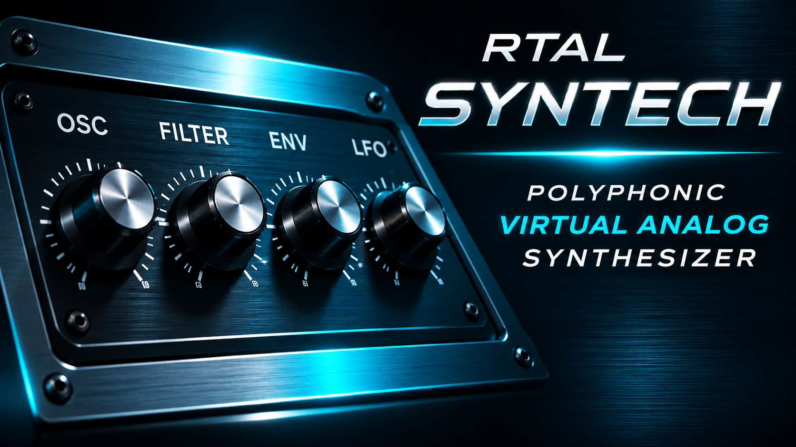

> This manual describes firmware V1.0.0 FINAL and its touchscreen interface. Historical screenshots showing 44.1 kHz do not specify the current operating rate: the reviewed source code uses **32 kHz / 256 frames**. A compatible SD-card preset bank is required for full operation; it is not included in the source archive.

## 1. Getting to Know the Instrument

RTAL SYNTECH is a standalone polyphonic digital synthesizer built around an ESP32-S3. Its sound engine combines two oscillators per voice, a mixer, a noise source, a multimode filter, two envelopes, LFOs and effects. You control it through the JC4827W543's 480 × 272-pixel touchscreen. DIN MIDI and USB MIDI provide control from keyboards, sequencers and DAWs.

**Key terminology:** A *voice* is one sounding note. A *layer* (UPPER/LOWER) is a separately editable sound section. A *preset* stores sound parameters. An *LFO* generates slow periodic modulation. An *XRUN* indicates that an audio processing deadline has been exceeded.

### 1.1 Features at a Glance

| Feature | V1.0.0 FINAL |
|:--|:--|
| Audio | 32,000 samples/s, 256-frame blocks, I²S |
| Polyphony | Up to 6 voices under normal conditions |
| Voice architecture | 2 oscillators, noise, filter, envelopes, LFO/matrix |
| Layers | UPPER / LOWER |
| Play modes | SINGLE, SPLIT, DOUBLE |
| Effects | Chorus, reverb |
| Presets | P000–P127, SD-card dependent, `.rtal` file extension |
| MIDI | DIN and USB; notes, Program Change, CC, Learn |
| Interface | LVGL 8.4 touchscreen GUI |

## 2. Hardware and Connections

### 2.1 Required Components

- JC4827W543 board with ESP32-S3, NV3041A QSPI display and GT911 touch controller.
- Suitable power supply and a USB cable compatible with the board.
- microSD card containing compatible SYNTECH preset files.
- An I²S DAC compatible with **32 kHz** (or a suitable audio output stage), plus amplifier or powered speakers.
- Optional: properly designed, galvanically isolated DIN MIDI IN circuit and a MIDI OUT driver circuit. Do not wire MIDI DIN connectors directly to unprotected GPIO pins.

### 2.2 GPIO Assignment According to the Firmware

| Signal | ESP32-S3 GPIO | Purpose |
|:--|--:|:--|
| I²S BCLK | 16 | Bit clock to DAC |
| I²S LRCK / WS | 15 | Audio word-select clock |
| I²S DOUT | 7 | Audio data |
| DIN MIDI RX | 17 | UART input, 31,250 baud |
| DIN MIDI TX | 18 | UART output, 31,250 baud |
| SD SCK / MISO / MOSI / CS | 12 / 13 / 11 / 10 | SPI SD card |

Display and touch pins are described in `PINS_JC4827W543.h`. **Important:** A GPIO assignment table is **not a complete electrical schematic**. DIN MIDI in particular requires standards-compliant input circuitry and output drivers. Do not connect the DAC to unsuitable supply voltages.

### 2.3 Software and Building

The source code specifies Arduino IDE **2.3.10**, Arduino-ESP32 core **3.3.11** and LVGL **8.4.x**. Programming requires a suitable ESP32-S3 board profile, correct PSRAM/flash settings and USB OTG (TinyUSB). Open the `.ino` sketch with all accompanying header and C/C++ source files in the same project. A fully reproduced hardware installation is still listed as outstanding in the release audit.

## 3. First Startup

1. Back up existing SD-card presets before flashing. The firmware does **not** automatically recreate missing factory preset files.
2. Create `/RTAL_SYNTECH/PRESETS/` on the SD card and provide at least one valid, compatible `Pxxx.rtal` file. For a complete library, provide P000 through P127.
3. With power disconnected, connect the I²S DAC and MIDI interface correctly. Start with the audio volume low.
4. Power on the device. The SYNTECH startup image appears. The system checks the SD card and preset structure, then loads the first usable patch, preferably P000.
5. If an SD/preset error appears, check the storage medium, folder, file names and format. Normal synthesis does not start without a valid preset.
6. Set the MIDI keyboard to the channel displayed in MIDI SETUP (factory default: channel 1). Play a note to check the audio output.

**Preset compatibility:** The current firmware requires preset file format version 2, including a header, payload size and CRC. Arbitrarily renamed files and older/incompatible dumps will not load.

## 4. Main User Interface

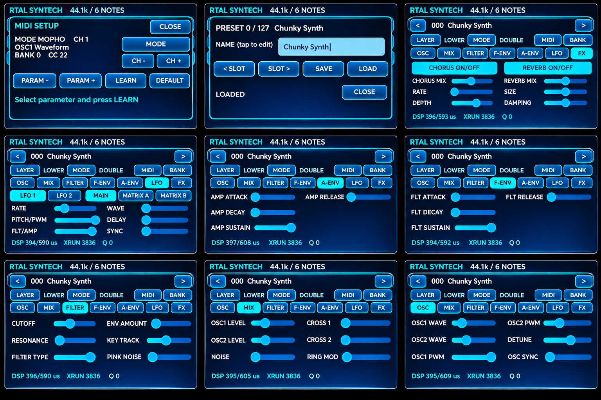

The top bar shows the preset number and patch name. Arrow buttons change the selected number. **LAYER** selects UPPER/LOWER; **MODE** selects the play mode. **MIDI** opens MIDI settings and **BANK** opens the preset dialog. The main tabs are **OSC**, **MIX**, **FILTER**, **F-ENV**, **A-ENV**, **LFO** and **FX**.

The diagnostic line `DSP ... us | XRUN ... | Q ...` helps monitor operation and troubleshoot issues. DSP is the measured processing time, XRUN indicates a missed audio deadline and Q displays the relevant command-queue diagnostic. Historical screenshot readings cannot be compared directly across firmware versions.

### 4.1 Sliders and Information Popups

Touch and drag a slider to change its parameter. A stationary long press may open a parameter information popup after **1.5 seconds**; moving the slider interrupts that delay. The popup is intended to display the current parameter and value. MIDI Learn assignments can be made through the corresponding dialog.

### 4.2 Preset Arrow Buttons

A short tap advances by one slot. Holding an arrow enables accelerated repeat: after approximately 500 ms the steps speed up to roughly 250 / 150 / 75 ms. While held, the selection remains a **preview**; releasing the button triggers a single preset load. This keeps SD-card I/O largely decoupled from the audio engine.

## 5. Oscillators — OSC

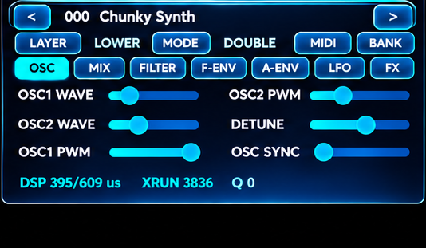

**OSC1 WAVE / OSC2 WAVE:** Choose the waveforms of both sound generators. Different waveforms alter the harmonic spectrum, from mellow to bright. **OSC1 PWM / OSC2 PWM:** Adjust pulse width, particularly useful for animated, chorus-like timbres. **DETUNE:** Detune the second oscillator relative to the first. **OSC SYNC:** Enable oscillator synchronization. Small detuning produces beating; sync can create pronounced harmonic sweeps.

**Try this:** Set both oscillators to similarly strong waveforms, detune OSC2 slightly and soften the result with the filter for a broad analog-style basic sound.

## 6. Mixer and Cross-Modulation — MIX

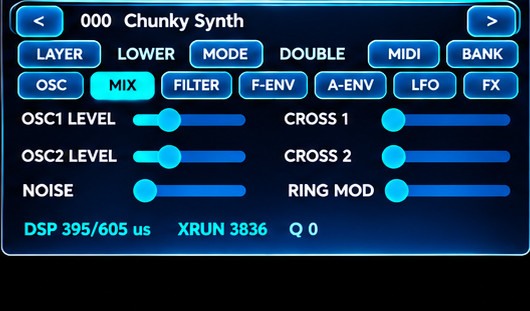

**OSC1 LEVEL / OSC2 LEVEL:** Balance the two oscillators. **NOISE:** Add noise to the sound. **CROSS1 / CROSS2:** Additional oscillator cross-modulation producing metallic, aggressive or complex spectra. **RING MOD:** Ring modulation for bell-like or inharmonic timbres. These processing options have both musical and CPU costs.

**CPU note:** The firmware offers six voices, but high CROSS1/CROSS2 values and complex waveforms can exhaust the available processing time. If you hear clicks, first reduce the number of simultaneous notes or cross-modulation depth. Automatic reduction to four voices is **not guaranteed** by this firmware.

## 7. Filter — FILTER

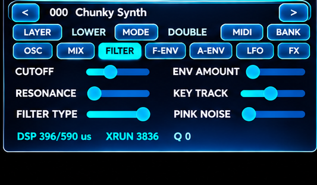

**CUTOFF** controls the cutoff frequency, while **RESONANCE** emphasizes frequencies around that cutoff. **FILTER TYPE** switches between the available filter modes, including the musically tuned LP24 mode. **ENV AMOUNT** sets the filter envelope's influence; **KEY TRACK** makes the filter response depend on note pitch. **PINK NOISE** toggles the corresponding noise option.

When loading presets, firmware V1.0.0 uses the developed *MUSICAL LP24* resonance response as the default. The exact frequency response depends on the preset, note pitch, resonance, modulation and firmware implementation. High resonance can substantially change level and character; adjust volume carefully.

## 8. Filter Envelope — F-ENV

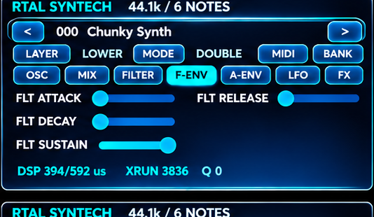

The filter envelope shapes the filter movement after a key is pressed: **ATTACK** (time to peak), **DECAY** (fall to the sustain level), **SUSTAIN** (level while the key is held) and **RELEASE** (return after key release). The audible result depends strongly on **ENV AMOUNT** on the filter page. For brass sounds, try short attack, medium decay and moderate sustain; for floating pads, use longer attack and release.

## 9. Amplifier Envelope — A-ENV

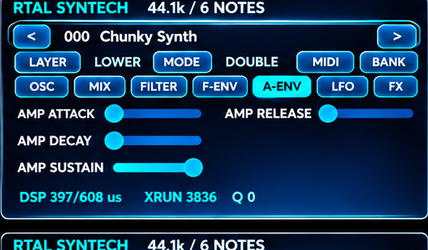

**AMP ATTACK**, **AMP DECAY**, **AMP SUSTAIN** and **AMP RELEASE** determine the volume contour over time. Short attack and release values produce precise, percussive sounds; longer settings result in smooth fades. With high polyphony and long release times, voices may remain occupied longer.

## 10. LFOs and Modulation Matrix

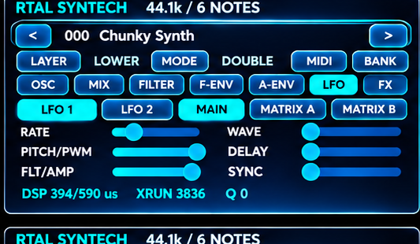

SYNTECH includes two LFOs. The LFO view provides **RATE**, **WAVE**, **PITCH/PWM**, **FLT/AMP**, **DELAY** and **SYNC** controls. Select the modulator with **LFO 1** or **LFO 2**; **MAIN** displays its principal settings. The two matrix pages allow targeted modulation with positive or negative amounts.

### 10.1 MATRIX A: Pitch / PWM

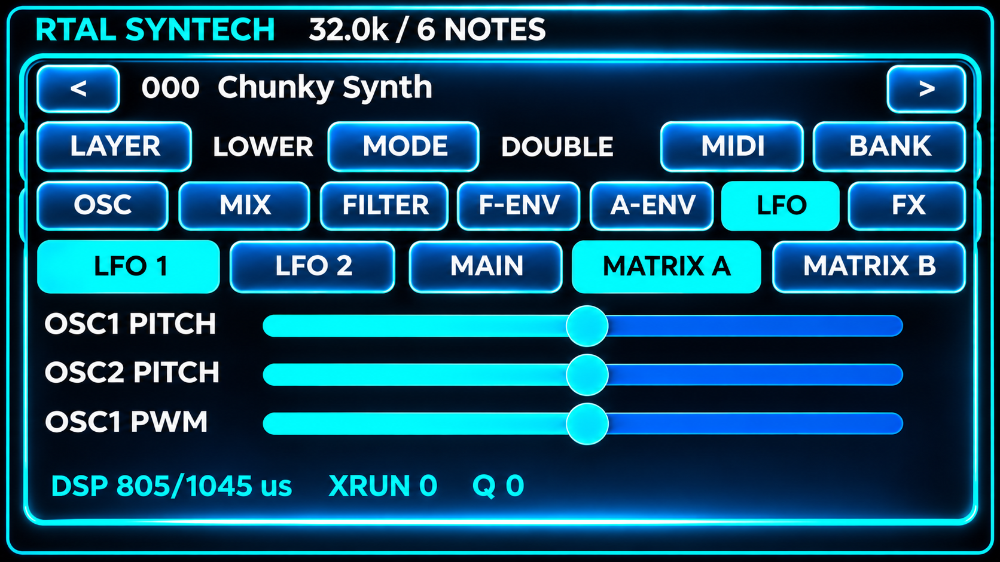

**OSC1 PITCH**, **OSC2 PITCH** and **OSC1 PWM** control modulation intensity. PITCH produces vibrato or broader pitch movement; PWM creates periodic timbral changes.

### 10.2 MATRIX B: PWM / Filter / Amplitude

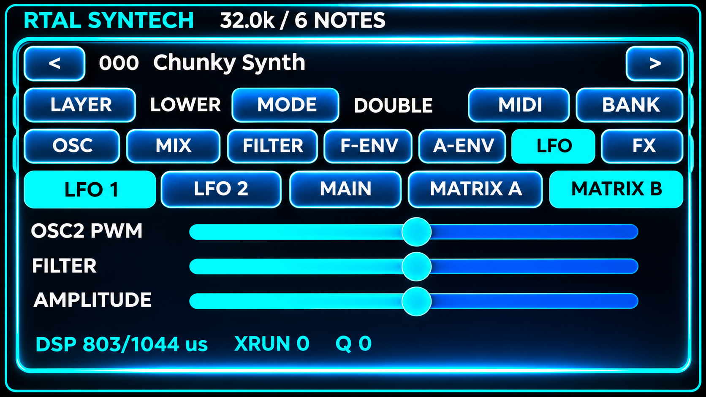

**OSC2 PWM**, **FILTER** and **AMPLITUDE** modulate the second oscillator's pulse width, filter and volume respectively. Use AMPLITUDE for tremolo, FILTER for automated sweeps and PWM for moving timbres. Bipolar MIDI matrix values use **64 as the center/zero position**, 0 as the negative extreme and 127 as the positive extreme.

### 10.3 Sound Examples

**Vibrato:** Set LFO1 to a slow or medium rate and use a small amount on OSC1+OSC2 Pitch. **PWM pad:** Use a slow LFO1, moderate amounts for both PWM destinations and a long AMP release. **Wah:** Route LFO2 to FILTER, raise resonance and use moderate ENV AMOUNT. **Tremolo:** Route LFO1 to AMPLITUDE and select an appropriate LFO waveform.

## 11. Effects — FX

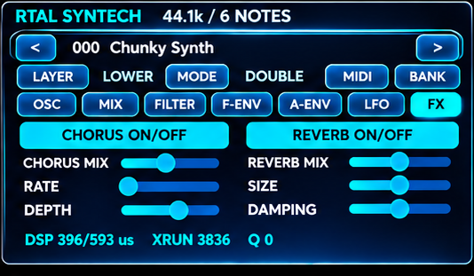

**CHORUS ON/OFF** enables a wider, animated chorus effect. **CHORUS MIX** sets its contribution, **RATE** its movement speed and **DEPTH** its modulation depth. **REVERB ON/OFF** enables room-like reverberation; **REVERB MIX**, **SIZE** and **DAMPING** control the wet level, sense of space and damping. For well-defined basses, use less reverb; for pads, try more chorus and moderate reverb.

## 12. Layers and Play Modes

**UPPER / LOWER:** Use LAYER to choose which sound layer to edit. **SINGLE** uses one sound, **SPLIT** divides the keyboard at a selected split note, and **DOUBLE** layers two sound components. In DOUBLE mode, one key press may consume more than one internal voice; the maximum number of simultaneously playable notes depends on the mode and DSP budget. The split point can be addressed by MIDI CC; refer to the CC reference document.

## 13. Presets and SD Card

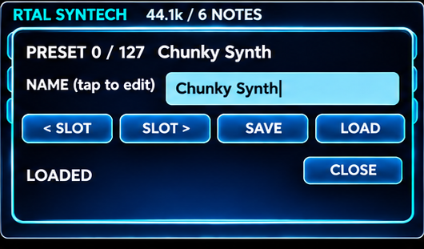

### 13.1 Storage Locations

The firmware uses `/RTAL_SYNTECH/PRESETS/P000.rtal` through `/RTAL_SYNTECH/PRESETS/P127.rtal`. P000–P079 are designated as the factory area and P080–P127 as the user area. **Important:** UI and code paths allow saving; the term “factory” does **not** guarantee technical write protection. Back up your files before editing.

### 13.2 Loading a Preset

Select a preset slot with the arrow buttons and release, or open **BANK**, change the SLOT and press **LOAD**. The firmware validates header, file size, version and CRC. Missing or damaged files are not silently replaced.

### 13.3 Renaming and Saving

Open the preset dialog, tap the name field and edit the name. Select the destination SLOT and press **SAVE**. Check that overwriting an existing preset is acceptable. Saving uses a temporary file and backup/rename logic to improve data integrity, but this is not a substitute for an external backup.

### 13.4 Program Change

MIDI Program Change 0–127 addresses the corresponding preset numbers. **PC 0 = P000, PC 127 = P127**; PC127 has no special function. Some DAWs display Program Changes starting at 1, so the actual transmitted MIDI value is what matters.

## 14. MIDI Configuration and Control

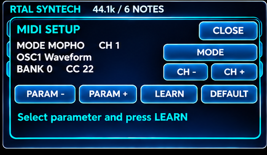

### 14.1 Interfaces and Channel

MIDI is processed through DIN UART and USB MIDI. DIN uses 31,250 baud. MIDI SETUP shows the active mode and channel. **CH − / CH +** change the MIDI channel from 1 to 16; the choice is retained in nonvolatile storage. A selectable OMNI mode is not established as a standard option by the reviewed source code. MIDI transmission and reception also depend on the connected controller and correct channel assignment.

### 14.2 STANDARD MODE

Every parameter has a direct CC number. For example, on channel 1: Filter Cutoff = CC27, Resonance = CC28, OSC1 Wave = CC14. No bank selection is required. This mode is suitable for controllers with many independently assignable knobs or sliders.

### 14.3 MOPHO MODE (Default)

**CC32** first selects a controller bank: 0 (oscillators/mixer/filter/performance), 1 (LFO1, FX and LFO1 matrix), or 2 (LFO2 and LFO2 matrix). A subsequent CC message addresses the parameter assigned in that bank. The selected bank remains active until changed. Example: send `CC32 = 0` followed by `CC102 = 100` to set Filter Cutoff; send `CC32 = 1` followed by `CC106 = 64` to control LFO1 Rate.

> Assignments are **bank dependent**: CC106 means Filter Env Amount in Bank 0, LFO1 Rate in Bank 1 and LFO2 Rate in Bank 2.

### 14.4 MIDI LEARN

In MIDI SETUP, select a parameter using **PARAM − / PARAM +**, then press **LEARN**. Move the controller that should control this parameter. The firmware checks reserved or ambiguous CCs and stores valid assignments separately for STANDARD and MOPHO. **DEFAULT** restores mappings for the active mode (a confirmation step may apply depending on the current UI state). MIDI Learn is not a general-purpose MIDI recorder; it needs a valid CC message on the selected channel.

### 14.5 Notes, All Notes Off and All Sound Off

Note On/Off messages start and end notes. **CC123 — All Notes Off** releases held notes according to MIDI behavior, while **CC120 — All Sound Off** stops playback immediately. In V1.0.0 both are processed even when MIDI Learn is active. If notes hang, check the MIDI channel, physical connection and whether your controller sends Note Off messages.

### 14.6 Extract from the CC Chart

| Parameter | STANDARD | MOPHO |
|:--|--:|:--|
| OSC1 Wave | CC14 | Bank 0, CC22 |
| OSC2 Wave | CC15 | Bank 0, CC26 |
| Filter Cutoff | CC27 | Bank 0, CC102 |
| Filter Resonance | CC28 | Bank 0, CC103 |
| LFO1 Rate | CC42 | Bank 1, CC106 |
| LFO2 Rate | CC45 | Bank 2, CC106 |
| Chorus Mix | CC48 | Bank 1, CC28 |
| Reverb Mix | CC51 | Bank 1, CC102 |

All **61 parameter mappings** are documented in [`MIDI_CC_REFERENCE.md`](MIDI_CC_REFERENCE.md) and in the original Excel workbook. MIDI Learn can change factory assignments.

## 15. Sound Design — Starter Patches

### 15.1 Warm Analog Pad

Choose two harmonically rich oscillator waveforms, slight detune, medium filter cutoff, low resonance, longer AMP attack/release and gentle chorus. A slow LFO routed to PWM adds movement without programming a sequence.

### 15.2 Punchy Synth Brass

Set strong levels for both oscillators, a short AMP attack, a medium-decay filter envelope, clearly audible ENV AMOUNT and moderately raised resonance. DOUBLE mode can widen the sound, but take voice usage into account.

### 15.3 Sync Lead

Enable OSC SYNC, tune the oscillators differently and combine with filter sweeps. Add subtle pitch vibrato using Matrix A. With strong cross-modulation, test single notes first and monitor XRUN.

### 15.4 Metallic / Bell Sound

Ring modulation and carefully controlled cross-modulation create metallic overtone spectra. For struck sounds, use short AMP attack and an appropriate AMP decay. Add a touch of reverb.

## 16. Operation, Performance and Troubleshooting

| Symptom | Possible cause | Recommended action |
|:--|:--|:--|
| No sound after boot | Missing or invalid SD presets | Check SD directory and at least one valid `.rtal` file |
| Display does not start | Board/flash setup or wiring | Verify JC4827W543 configuration |
| No MIDI response | Wrong channel, RX/TX swapped, missing interface | Check MIDI SETUP, 31,250 baud and wiring |
| No USB MIDI | Incorrect USB mode/host | Check TinyUSB/USB OTG and connection |
| Preset fails to load | CRC/version mismatch or missing file | Use a backup and compatible file format |
| Clicks during chords | DSP budget exceeded, especially CROSS1/2 | Play fewer notes and reduce modulation depth |
| XRUN counter rises | Audio task missed a deadline | Check patch load and system configuration |
| Touch behaves unexpectedly | Drag/touch behavior or release debounce | Lift finger completely and tap again |
| Slider information does not appear | Slider was moving / 1.5 s hold not reached | Keep finger stationary on the parameter |
| MIDI CC affects unexpected parameter | Wrong bank or MIDI Learn mapping | Check CC32, current mode and assignments |

**Audio timing:** 256 samples at 32,000 Hz correspond to **8 ms per audio block**. Processing must finish within this window with safety margin. A single screenshot without audible faults is not a substitute for a stress test.

## 17. Maintenance, Backups and Version Changes

Before updating firmware, back up the entire SD card, particularly `/RTAL_SYNTECH/PRESETS/`. `.rtal` files contain version-dependent binary data. Before changing firmware versions, verify explicit format compatibility. Do not overwrite unverified older presets. When sharing projects, record MIDI Learn assignments and the MIDI channel; these may be saved in NVS independently of presets.

## 18. Technical Appendix

**Engine:** fixed-point DSP based on Joakim Eriksson's SCINTILLA; **DSP sample rate:** 32 kHz; **block size:** 256 frames; **output:** 32-bit I²S slots, stereo; **UI:** LVGL; **tasking:** dedicated audio task, GUI/MIDI tasks and FreeRTOS command queues. Preset files contain a versioned binary header, CRC and a structure-dependent patch payload. Changes to `sc_patch_t` may affect file format compatibility.

**Sources:** the V1.0.0 FINAL firmware included in this release, `SyntechMidiCC.h`, the supplied MIDI Excel workbook and the provided UI screenshots. For development details, consult the [Release Audit](RELEASE_AUDIT_V1.0.0.md). This manual is not an electrical certification and does not guarantee a complete factory preset bank.

## 19. Acknowledgements, Licensing and Trademarks

**Joakim Eriksson** and his [SCINTILLA project](https://github.com/joakimeriksson/scintilla-fm1) provide a central source-code and DSP foundation. SYNTECH extends this work with its ESP32-S3 integration and touchscreen interface; the original author's contribution is explicitly acknowledged. The derivative firmware source package is distributed under GPL-3.0-only, subject to the included third-party notices. “Elka” and “Synthex” refer solely to historical inspiration; no official affiliation or endorsement is implied.

---

*RTAL SYNTECH · User Manual V1.0.0 · November 11, 2026*
